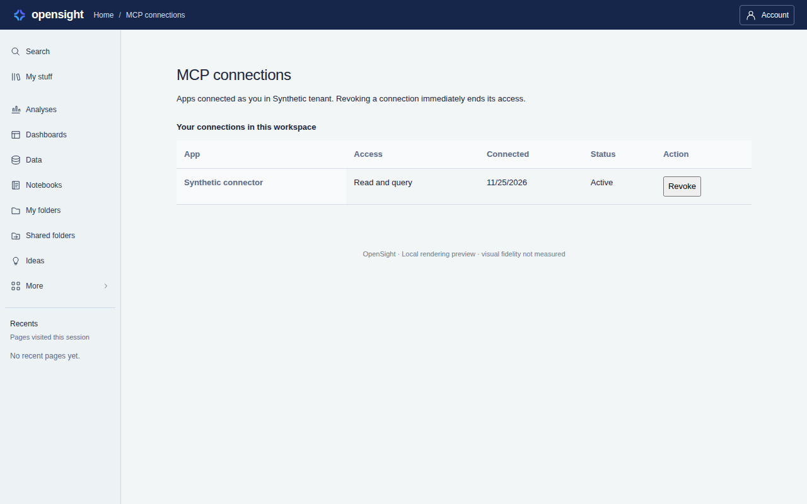

# Connectable MCP (#332)

[IDD D-95](idd/D-95-connectable-mcp.md) adds hosted Streamable HTTP and in-app
OAuth to the existing 58-tool v1 inventory. Local stdio, the CLI and SDKs keep
their existing behavior. The tool definitions, argument validation, result
shapes and error handling are shared between transports.

## Connect

Add `https://app.getopensight.org/api/mcp` to an MCP host. The host discovers
OAuth metadata, registers a public client, and opens OpenSight's normal
sign-in and workspace selection. The consent screen identifies the client,
return destination, member and workspace. Select requested permissions and
approve, or deny to return `access_denied` with the original state.

- `opensight/mcp.read`: GET tools, dataset/dashboard queries, asset search, and `ask_question`.
- `opensight/mcp.write`: all remaining generated operations.

Scopes do not grant role capabilities or dataset access. A reader cannot
become an author by granting write scope. Read-only connections hide writes
from discovery and reject attempted calls. Both transports still use v1's
CLS, PII stop, tenant isolation, compute quotas, rate limits, AI spend cap,
idempotency and member-attributed action history. Credentials and arbitrary
principal assertions never become tool arguments.

Manage grants from **Account → MCP connections**. Any member can list and
revoke their own connections in the current workspace. Revocation immediately
invalidates existing access and refresh tokens, including direct v1 attempts.
The demo displays a hosted-API notice rather than inventing a connection.

## Routes and protocol

| Route | Method | Purpose |
| --- | --- | --- |
| `/api/mcp` | POST | Stateless Streamable HTTP, JSON responses |
| `/.well-known/oauth-protected-resource` | GET | Resource discovery |
| `/.well-known/oauth-protected-resource/api/mcp` | GET | Path-specific resource discovery, linked from the 401 challenge |
| `/.well-known/oauth-authorization-server` | GET | Authorization server discovery |
| `/?mcp_oauth=1&…` | GET, app | Normal sign-in followed by consent |
| `/api/mcp/register` | POST JSON | Dynamic public-client registration, no secret |
| `/api/mcp/oauth/interaction` | POST JSON | Validate request and bind consent to the browser session |
| `/api/mcp/oauth/authorize` | POST JSON | Approve selected scopes or deny once |
| `/api/mcp/oauth/token` | POST form | `authorization_code` and `refresh_token` grants |
| `/api/mcp/oauth/revoke` | POST form | Revoke an access/refresh token's whole connection |
| `/api/mcp/connections` | GET / POST JSON | List own grants / revoke by ID |

The SDK negotiates supported MCP protocol versions. Clients send
`Accept: application/json, text/event-stream` and the negotiated
`MCP-Protocol-Version`. GET streams and DELETE sessions return 405: the server
keeps no transport session, SSE history or in-memory credential authority.
Batch JSON-RPC requests are rejected. Requests are bounded at 1 MiB; OAuth
bodies at 16 KiB. Cancellation propagates into the existing HTTP bridge.

Registration permits HTTPS redirects and HTTP loopback redirects with an
explicit port; no credentials or fragments. Redirect matching is exact.
S256 PKCE is mandatory, with one-use 60-second codes and a 10-minute consent
interaction bound to the authenticated H2 session. Browser mutation routes
require the configured origin; cookie-only or MCP-token consent is refused.
The app clears authorization parameters from its URL and retains them only
in memory during sign-in. An interrupted/reloaded flow must restart.

Access tokens last one hour. Refresh tokens rotate on every exchange and
have a fixed 30-day connection lifetime. Successful credential replay revokes
the token family; wrong-client or wrong-PKCE attempts cannot revoke another
client's grant. Scope narrowing persists across refresh and older access
tokens. Every admission checks current identity, membership, tenant, key and
workspace authority. Only hashes of opaque codes/tokens are stored.

## Storage, configuration and deployment

No new external dependencies or configuration secrets. URLs derive only from
`OPENSIGHT_PUBLIC_ORIGIN`; existing H2 signing-key identity, issuer/audience,
durable membership database and host/origin checks remain authoritative.
The MCP bundle audits every contributing dependency against MIT/Apache-2.0.
The internal v1 bridge makes no network request.

`initializeAuth` creates `h2_mcp_clients`, `h2_mcp_interactions`,
`h2_mcp_grants` and `h2_mcp_tokens` in the membership/operator database.
Invocation handlers perform no DDL. The owner migration, runtime grants,
backup inventory, registered legacy upgrade and restore fences include all
four tables. Restore revokes grants/tokens and discards pending consent.
Tenant deletion purges that tenant's grants/tokens; shared public-client
registrations contain no member identity. Existing auth attempt buckets rate
limit OAuth routes, and registration is capped at 10,000 clients.

Deploy with the normal hosted build and registered schema migration. The
frontend serves the authorization entry at `/`; the reverse proxy must route
`/api/mcp` and the three exact discovery paths to the API without caching or
stripping OAuth/MCP headers. The existing CloudFront configuration only
forwards `/api/*` and `/embed/sessions/*`: routing the discovery paths is a
required deploy-time change for Tom, outside this no-AWS build. The shared
ingress and generated viewer validator already admit the exact paths.
No infrastructure was applied and no hosted connector was contacted.

## Verification

Root `npm test` includes protocol, OAuth, browser component, ingress,
backup/migration and HTTP governance suites. They use synthetic members and
local APIs, including the official Streamable HTTP SDK client against real
OAuth-issued tokens. The managed AI test provider makes no external calls.

J10 now defaults to hosted HTTP with dynamic registration, consent and PKCE;
`OPENSIGHT_J10_MCP_TRANSPORT=stdio` retains the earlier in-memory protocol
journey. Its separate Postgres persona harness is available to the supervisor;
the root suite's SQLite HTTP governance tests exercise PII, CLS, spend,
compute, role changes, cross-owner/tenant isolation and action attribution.
Tom's post-deploy Muse connector and harmless-read proof remains required,
as does the brief's independent cold auth review before merge.
