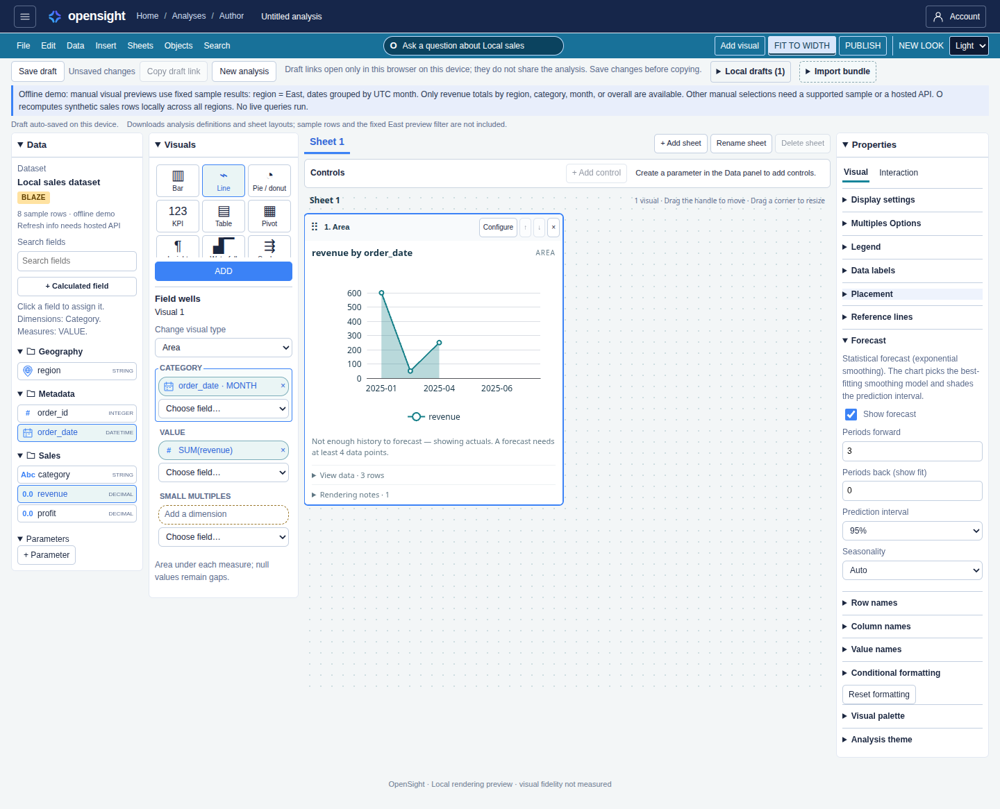

# Forecasting on line and area charts — issue #235

A line or area chart whose category field is a date dimension can carry a forecast:
a dashed continuation of each series, a shaded prediction interval, and a
thin divider at the last actual period. The configuration lives on the chart
(QuickSight `ForecastConfigurations` shape on import/export) and is edited in
the Properties panel's **Forecast** section, which appears only for line and
area charts with a date dimension. Periods forward (default 3), periods back —
which renders the model's fitted values over the trailing periods so a reader
can judge the fit — prediction interval (80/90/95%, default 95%), and
seasonality (Auto / None / Custom period) are the controls.

## Method

The forecast is classical statistics, not machine learning, and the product
says so: a "statistical forecast (exponential smoothing)". Per series, the
pure module `packages/web/src/forecast.ts` fits an exponential-smoothing
(ETS) candidate family — level-only, Holt trend, damped trend, and
Holt-Winters seasonal variants when a season length applies — by a bounded
deterministic search minimizing one-step-ahead error, and picks the winner
by corrected AIC. The prediction interval comes from the one-step residual
variance and widens with horizon through the model's state-space
psi-weights, at the configured level. Auto seasonality proposes the period
from the grain (day → 7, month → 12, quarter → 4, year → none) and admits
seasonal models only with at least two full cycles of history. When every
actual is non-negative the interval's lower edge clamps at 0; imported
QuickSight `LowerBoundary`/`UpperBoundary` values clamp the forecast and its
interval. The computation runs in the web layer's chart compiler, so author
view, dashboards, small multiples, and PDF export all show the same result.

Area charts use the same forecast computation and overlay as line charts,
including one forecast per measure in each small-multiples panel. Actual
series keep their area fill; fitted and future forecast segments are unfilled
dashed lines, joined to the last actual point. Only the prediction-interval
band has a translucent fill. The category axis extends by the selected date
grain for future periods. Area forecasts import and export as
`ForecastConfigurations` on a `LineChartVisual` with `Type: AREA`; disabled
forecasts remain in the draft and are omitted from the exported definition,
just as on line charts.

## Minimums and render-time states

A forecast needs at least 4 data points. With fewer, the chart renders
actuals only with a quiet note under the chart; when a seasonal fit was
requested without two full cycles, a trend forecast still renders and the
note says the seasonal part was skipped. Both states are decided at render
time, so a dashboard whose data later shrinks degrades honestly. A stored
forecast on a chart whose category is not a date dimension is ignored with a
rendering warning and never breaks saving or viewing.

Out of scope: anomaly detection, the insight visual's `ForecastComputation`
(it stays `INSIGHT_FORECAST_UNSUPPORTED`; it is the named v2 reuse of
`forecast.ts`), Ask O forecast phrasing, and forecasts on other chart types.

The static demo has three date buckets, so enabling a forecast there shows
the minimum-history note. This capture shows the area chart's Forecast controls:

See [area parity verification and visual review](parity-forecast-area-gap-notes.md).
