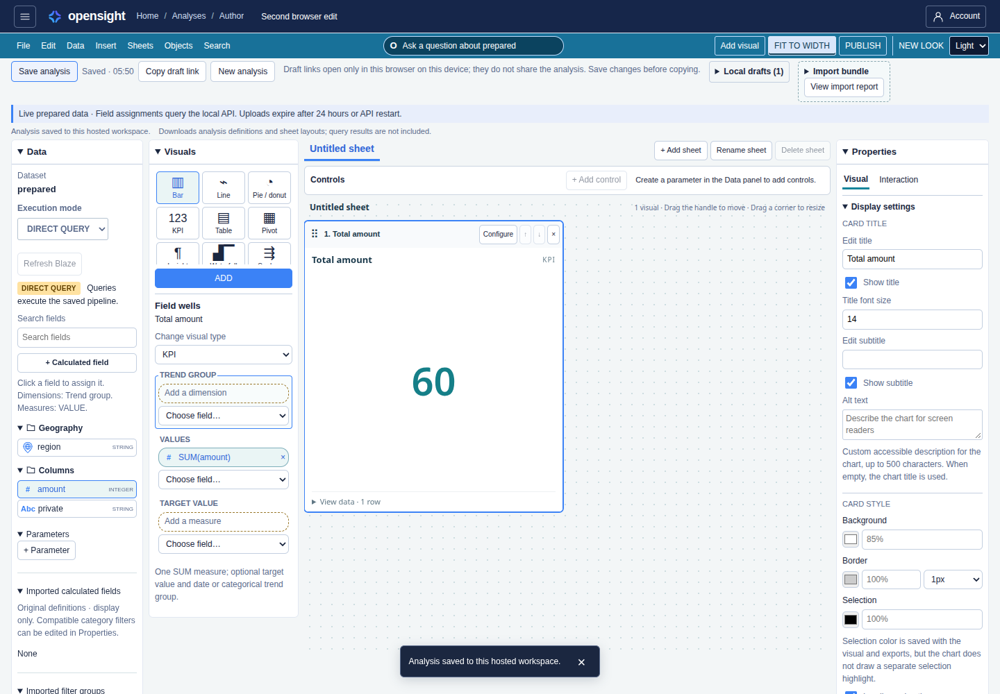

# Issue #336: full-app embed verification

Branch: `work/issue-336-full-app-embed`. This implements D-102 Q1 and the seven
items in the approved run brief. `SOLUTION_DESIGN.md`, dependencies and the four
fixed experience test files are unchanged. No AWS, remote service, deployment,
merge or push is part of this build.

## Implementation choices

- `FullApp.InitialPath` is a closed initial-route allowlist. The grant carries
  the registered principal and namespace; the starting asset is not an implicit
  grant to any other resource. Navigation and direct API operations both check
  current capability, tenant feature flags, ownership and resource grants.
- The bridge delegates to existing data/AI/v1 handlers. It adds no query planner,
  source connection or alternative RLS/CLS implementation.
- Analysis saves use the standalone D-44/D-45 CAS mutation, which does not change
  the authorization revision. Full-app metadata writes additionally hold session
  and signing-key authority until commit. On PostgreSQL those locks and checks
  use the operator connection while the mutation retains the restricted tenant
  connection. A deterministic two-connection protocol test refuses any session
  table read through the restricted facade. Live PostgreSQL is a separate check.
- Drafts and hosted analysis links use frame-local memory. The real editor keeps
  its existing dataset/rebinding semantics; this work does not add multi-dataset
  editing or import parity. AI readers use published-dashboard questions;
  authors can also use their prepared datasets.
- The SDK extension is types only. The existing v2 URL mounting protocol already
  supports the new surface. Per-embed visibility, theme tokens and navigation or
  contextual save events remain later D-102 steps.

## Browser verification and visual comparison

Final focused suites run by the builder:

| Suite | Passed | Failed | Skipped |
| --- | --- | --- | --- |
| API `embed*.test.mjs` (H5/H6/v1 and full app) | 62 | 0 | 1 |
| Web embed, hosted publish, app navigation and bundle round-trip | 156 | 0 | 0 |
| Embedding SDK (including type-contract compilation) | 10 | 0 | 0 |

The single focused skip is the existing live-Postgres integration test because
`DATABASE_URL` is unset. Browser hover cases ran with the environment's existing
Chromium policy wrapper. Earlier overlapping verification was superseded by this
sequential run to avoid fixture timeouts from resource contention.

`packages/api/scripts/verify-full-app-browser.mjs` uses the existing Chromium and
Playwright installation, a real hosted HTTP API on loopback, synthetic SQLite
metadata, encrypted uploads and the real v2 SDK. All browser HTTP traffic is
intercepted; only the loopback fixture performs I/O. This is not a deployed
server or a live PostgreSQL test.

Eight checks passed: the real editor reopened a bound analysis, rendered its
live KPI total of 60, saved twice with one redeem and no browser storage, and
navigated to Data without another bootstrap. Separate initial mounts covered
the dashboard list, a published dashboard, Data, a new editor, preparation and
configured Ask O. There were no page errors or external requests.

```sh
OPENSIGHT_CHROMIUM=/home/hatch/workspace/tools/chromium-wrapper.sh \
node packages/api/scripts/verify-full-app-browser.mjs
```

The executable override is specific to this build environment's existing
Chromium policy wrapper; other environments can provide their own executable.
Screenshots and non-secret evidence are written to `/tmp/issue336-browser`.



The 1440px frame was compared visually with `docs/images/author.png`: the same
Data → Visuals/field wells → analysis canvas → Properties ordering, compact
controls, toolbar and dominant sheet are present. The changed dataset, live
query total and hosted Save analysis status are expected. This is a structural
comparison, not a measured visual-parity score; visual fidelity is not measured.

Browser verification caught and fixed the editor's missing dataset-metrics
allowlist entry. Review caught and fixed operator/tenant SQL separation in the
write guard. No unresolved issue-specific visual gap was identified. Existing
app chrome and local-draft wording remain the app's own presentation; the
subsequent D-102 visibility work controls which chrome a host shows.

The single-file static demo was rebuilt from the final source. The README hero
GIF was recaptured with the existing `readme-gif.mjs` storyboard (a temporary
copy adapted to the current hash routes, rebuilt demo path and browser wrapper)
and its documented ffmpeg palette/assembly steps: 35 frames, no page errors,
all external HTTP blocked. The first and last captures were visually inspected.
The new feature screenshot is included without replacing the four fixed
experience screenshots. No static artifact is represented as a deployed server.
